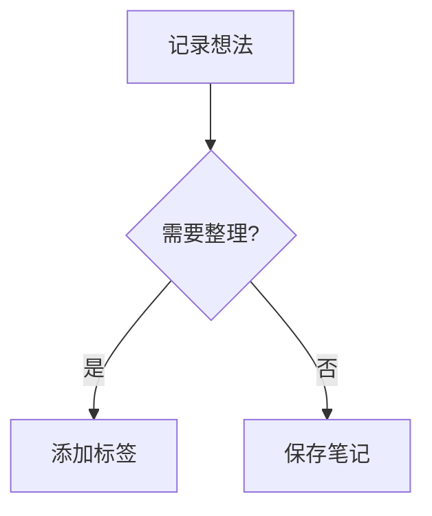
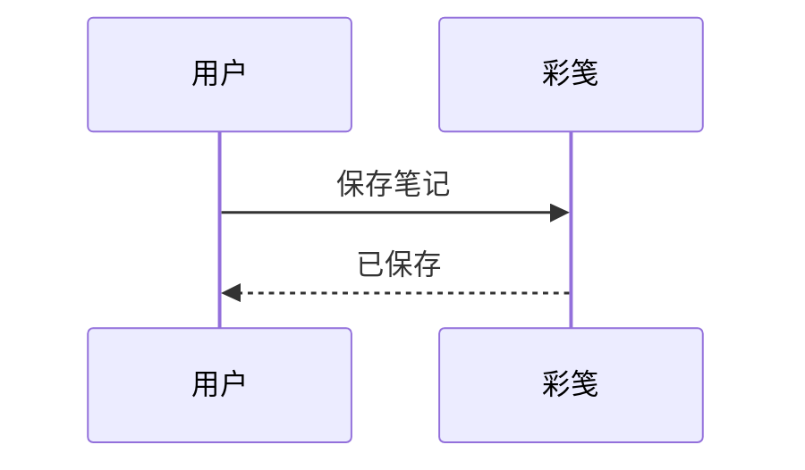

# Mermaid 与数学公式

在便签正文或白板说明中输入 Markdown，切换到「预览」即可看到图表与公式。渲染组件和字体随应用提供，无需联网；正文中的 HTTPS 远程图片仍按原规则联网加载。

用标记为 `mermaid` 的代码块绘制流程图、时序图、类图、状态图等：

````markdown



````

行内公式使用 `$…$` 或 `\(…\)`，例如 `能量 $E=mc^2$`。

独立公式使用 `$$…$$` 或 `\[…\]`，支持换行：

```latex
$$
\int_0^1 x^2\,dx = \frac{1}{3}
$$
```

也可使用标记为 `math` 或 `latex` 的代码块。公式由 KaTeX 渲染，支持分式、根式、上下标、矩阵及 `aligned` 等常用 LaTeX 数学语法；完整命令范围见 [KaTeX 支持列表](https://katex.org/docs/supported.html)。代码示例与转义的 `\$` 保持原样。

语法有误时保留图表或公式源码，不影响后面的正文。超宽图表、公式和表格可横向滚动。渲染跟随应用明暗主题和系统字号；Android System WebView 应保持更新。Mermaid 每个图表最多 50,000 个字符、500 条边。

含图表或公式的预览仍支持待办勾选和本地图片打开；待办修改需要点击「保存」，回收站只读。Markdown 原文保存在笔记中，JSON 备份、加密同步和 Markdown ZIP 导出保留图表与公式语法；其他编辑器需支持相应语法才能渲染。

开发验证：`node --test tests/markdown-preview.test.cjs` 检查真实公式渲染、图表语法、代码及转义、任务源位置、图片限制和离线资源完整性。`python3 tools/verify-termux.py` 同时运行这些检查、JVM 单元测试、Android 源码编译和 Lint，不生成 APK。资源版本、下载完整性与刷新方法见 [vendor-markdown.py](../tools/vendor-markdown.py)，执行 `python3 tools/vendor-markdown.py` 可从固定版本恢复资源；下载缓存位于 `~/tmp/colormemo-markdown`。

设备验收：分别在便签、白板说明和回收站预览上述内容；断网检查图表与公式；混排重复待办、本地图片、HTTPS 图片及表格，检查勾选保存和图片打开；切换明暗主题、大字号、横竖屏，检查图表宽度与正文纵向滚动；连续勾选和退出预览，检查旧渲染结果不会覆盖新内容。
